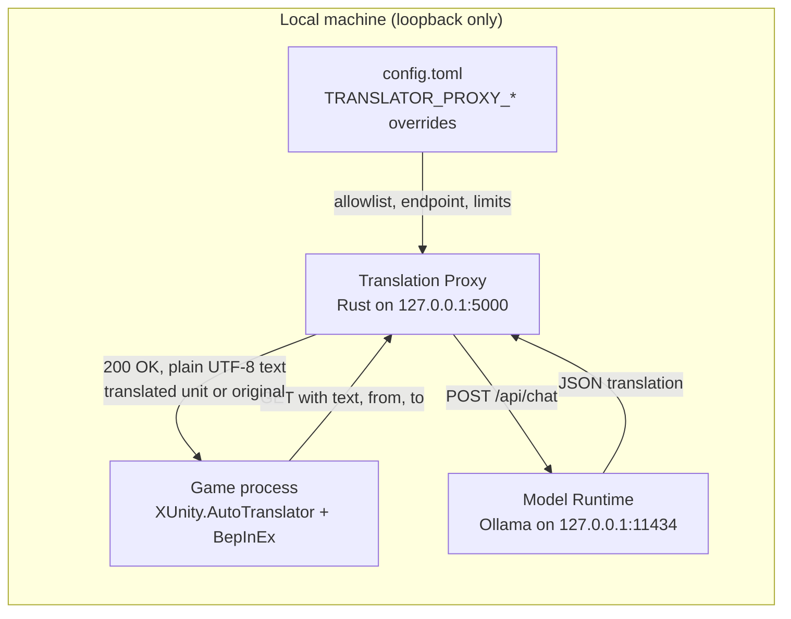
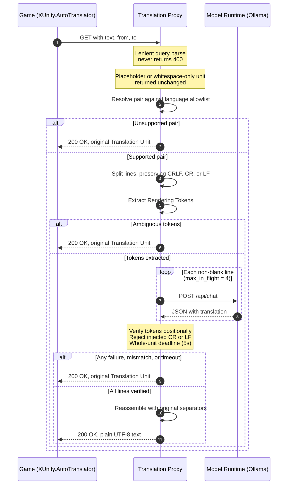

# local-translator-proxy

A local, game-facing Translation Proxy. It accepts the game's existing `GET`
request, translates each line through a separately installed Model Runtime, and
returns raw UTF-8 plain text. When translation cannot be supplied safely it
returns the original Translation Unit unchanged (a Passthrough Response) instead
of failing the game request.

The game call site is unchanged: the proxy listens on `127.0.0.1:5000` and keeps
the MVP `text` / `from` / `to` query parameters.

## Architecture

The proxy is a local service between an unchanged game and a separately
installed Model Runtime. The game still calls one loopback URL; the proxy
handles line splitting, concurrency, verification, and safe failure.



The game's request is unchanged:
`GET http://127.0.0.1:5000/?text=...&from=zh-CN&to=en`. The proxy binds loopback
only (ADR-0002) and returns `200 OK` with `text/plain; charset=utf-8` for both
translations and Passthrough Responses.

One Translation Request, end to end:



**What "live" means here**

- Translation is request/response per Translation Unit; nothing is streamed.
- `timeout_secs` (default `5`) bounds the whole unit: allowlist check, permit
  waits, every model call, and verification.
- Non-blank lines are translated concurrently, capped by `max_in_flight`
  (default `4`).
- Model calls are stateless: no retries and no caching.
- Any unsafe step returns a Passthrough Response, so the game never stalls.

Internally the flow is `http` → `pipeline` (`language`, `lines`, `tokens`) →
`runtime`. See [`docs/agents/architecture.md`](docs/agents/architecture.md) for
the module map and invariants.

## Requirements

- Rust 1.85+ (the crate uses edition 2024)
- A Model Runtime exposing an Ollama-compatible `POST /api/chat` endpoint
  (the reference target is [Ollama](https://ollama.com))

### Windows

Rust's default Windows target is `x86_64-pc-windows-msvc`, which needs the
Microsoft linker and Windows SDK. Install
[Visual Studio Build Tools](https://visualstudio.microsoft.com/visual-cpp-build-tools/)
and select the **Desktop development with C++** workload. Without it,
`cargo build` fails with an error such as `linker 'link.exe' not found`.

Alternatively, build with the GNU toolchain and MSYS2's MinGW-w64 binutils:

```powershell
rustup toolchain install stable-x86_64-pc-windows-gnu
$env:PATH = "C:\msys64\mingw64\bin;" + $env:PATH
cargo +stable-x86_64-pc-windows-gnu build --release
```

## Build and run

```sh
cargo build --release
cargo run --release
```

`config.toml` is tracked with working defaults, so a fresh clone runs without
extra setup. Edit it directly for local changes; `config.example.toml` is the
fully documented template.

The proxy starts on `127.0.0.1:5000` unless `config.toml` or an environment
override says otherwise. Logging is controlled by `RUST_LOG` (default `info`).

At the default `info` level, the console prints one line per verified physical
line, including the source text and its translation:

```text
INFO local_translator_proxy::pipeline: line=0 from=zh-cn to=en source="你好" translated="Hello"
```

Rejected model output is logged at `warn` and labelled `rejected`; it is never
returned to the game. Failures and timeouts log the original Translation Unit at
`warn`. Expected passthroughs (an unsupported language pair or ambiguous
Rendering Tokens) are logged at `debug`.

To see those debug diagnostics:

```powershell
$env:RUST_LOG = "debug"
cargo run
```

To hide translation pairs while preserving warnings:

```powershell
$env:RUST_LOG = "info,local_translator_proxy::pipeline=warn"
```

To also hide rejected warnings:

```powershell
$env:RUST_LOG = "info,local_translator_proxy::pipeline=error"
```

For the reference Model Runtime:

```sh
ollama pull gemma2:9b
ollama serve
```

## Configuration

Configuration is read from `config.toml` in the working directory. The
repository tracks `config.toml` with working defaults; `config.example.toml` is
the documented template. Edit `config.toml` directly, or use the environment
overrides below.

| Key | Default | Meaning |
|---|---|---|
| `server.listen_addr` | `127.0.0.1:5000` | Loopback address to bind |
| `model_runtime.endpoint` | `http://127.0.0.1:11434/api/chat` | Model Runtime chat endpoint |
| `model_runtime.model` | `gemma2:9b` | Model name sent to the runtime |
| `model_runtime.timeout_secs` | `5` | Deadline for one whole Translation Unit |
| `model_runtime.max_in_flight` | `4` | Maximum concurrent Model Runtime calls |
| `model_runtime.seed` | `12345` | Deterministic sampling seed |
| `languages.supported_pairs` | `[["zh-CN", "en"]]` | Fixed source-to-target allowlist |
| `languages.default_from` | `zh-CN` | Used when `from` is missing or empty |
| `languages.default_to` | `en` | Used when `to` is missing or empty |
| `prompt.system_message` | see `config.example.toml` | System instruction sent to the model |

### Environment overrides

Every scalar setting has a `TRANSLATOR_PROXY_*` override. Names use single
underscores inside section names, exactly as written here:

| Variable |
|---|
| `TRANSLATOR_PROXY_SERVER_LISTEN_ADDR` |
| `TRANSLATOR_PROXY_MODEL_RUNTIME_ENDPOINT` |
| `TRANSLATOR_PROXY_MODEL_RUNTIME_MODEL` |
| `TRANSLATOR_PROXY_MODEL_RUNTIME_TIMEOUT_SECS` |
| `TRANSLATOR_PROXY_MODEL_RUNTIME_MAX_IN_FLIGHT` |
| `TRANSLATOR_PROXY_MODEL_RUNTIME_SEED` |
| `TRANSLATOR_PROXY_LANGUAGES_SUPPORTED_PAIRS` |
| `TRANSLATOR_PROXY_LANGUAGES_DEFAULT_FROM` |
| `TRANSLATOR_PROXY_LANGUAGES_DEFAULT_TO` |
| `TRANSLATOR_PROXY_PROMPT_SYSTEM_MESSAGE` |

`TRANSLATOR_PROXY_LANGUAGES_SUPPORTED_PAIRS` takes a comma-separated list of
`from:to` pairs, for example `zh-CN:en,ja:en`.

## Game configuration

With XUnity.AutoTranslator, use the `CustomTranslate` endpoint and point it at
the proxy. The path is ignored, so either of these works:

```ini
[Service]
Endpoint=CustomTranslate

[Custom]
Url=http://127.0.0.1:5000/
```

## Behaviour

- `text` is percent-decoded UTF-8; `from` and `to` default to `zh-CN` and `en`.
- A literal `{text}` or whitespace-only request is returned unchanged.
- Lines are split on `\r\n`, `\r`, or `\n` and rejoined with the original
  separators. Blank lines are never sent to the model.
- Rendering Tokens are compared positionally. A mismatch, malformed token,
  model failure, or timeout returns the entire original Translation Unit.
- Responses are always `200 OK` with `Content-Type: text/plain; charset=utf-8`
  for game-safe failures.

## Development

```sh
cargo fmt --all
cargo clippy --all-targets -- -D warnings
cargo test
```

The v1 contract lives in [`docs/spec/v1.md`](docs/spec/v1.md); decisions are
recorded in [`docs/adr/`](docs/adr/).
